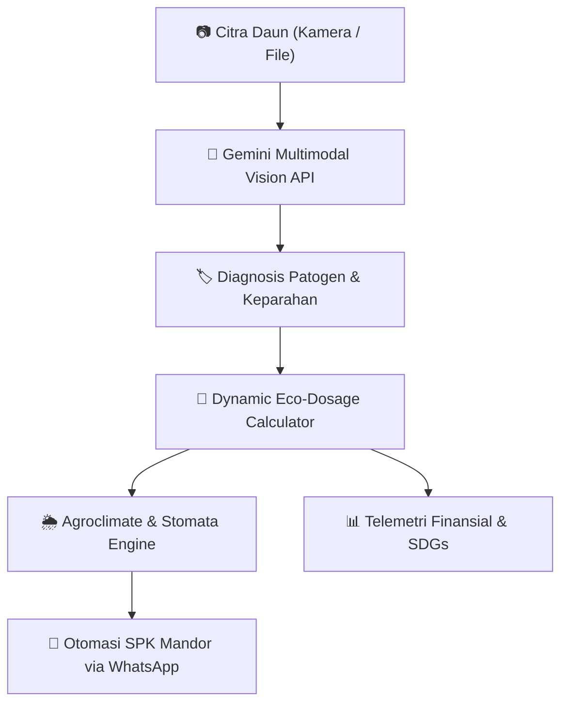

# 🌿 TaniPresisi AI — Smart Plantation & Sustainability
> **Dokter Daun Multimodal, Agroklimat Presisi & Otomasi Dosis Pupuk Berkelanjutan**

[](https://github.com/0MacroForge8/TaniPresisi)
[](https://ai.google.dev/)
[](https://sdgs.un.org/)
[](https://stitch.withgoogle.com/)

---

## 📌 1. Latar Belakang & Problem Statement
Sektor perkebunan dan pertanian tropis di Indonesia (khususnya Kelapa Sawit, Karet, Cabai, Padi, dan Kopi) menghadapi tiga tantangan kritis yang saling berkaitan:
1. **Keterlambatan Deteksi Penyakit Daun:** Gejala patogen seperti *Curvularia*, Karat Daun, Hawar, atau defisiensi hara sering terlambat diidentifikasi secara kasat mata, mengakibatkan penurunan produktivitas hingga 40%.
2. **Ketergantungan & Overdosis Pupuk Kimia Sintetis:** Praktik pemupukan konvensional berbasis taksiran (*blanket application*) menyebabkan pengeluaran biaya petani membengkak, keasaman tanah meningkat, serta limpasan residu nitrat/fosfat mencemari ekosistem sungai.
3. **Miskomunikasi Instruksi Lapangan:** Rekomendasi agronomis sulit dieksekusi tepat waktu karena tidak adanya standarisasi Surat Perintah Kerja (SPK) yang langsung terhubung ke gawai mandor lapangan.

---

## 💡 2. Solusi: TaniPresisi AI
**TaniPresisi AI** adalah platform *precision agritech* terintegrasi berbasis Computer Vision (**Google Gemini Multimodal API**) yang mendiagnosa kesehatan daun tanaman perkebunan secara instan, menghitung dosis presisi formula hayati ramah lingkungan per pohon, memitigasi risiko agroklimat cuaca, serta mengotomasi penerbitan Surat Perintah Kerja (SPK) ke mandor lapangan via WhatsApp dalam 1 klik.



---

## 🚀 3. Fitur Utama (Core Modules)

### 🩺 1. Dokter Daun AI Vision (Multimodal Computer Vision)
- **Multi-Source Ingestion:** Unggah foto berkas (JPG/PNG/HEIC/WebP), integrasi kamera perangkat *live*, atau pilih sampel daun terkalibrasi (*pre-embedded*).
- **Client-Side Canvas Compression:** Kompresi citra otomatis pada canvas HTML5 sebelum pengiriman API untuk meminimalkan latensi dan kuota data petani di area sinyal terbatas.
- **Cascading Fallback Model Architecture:**
  1. `gemini-3.8-flash` *(Frontier Speed & Agentic Reasoning)*
  2. `gemini-3.5-flash-lite` *(Ultra-Low Latency & High Volume)*
  3. `gemini-3.1-pro` *(Deep Agronomic Multimodal Reasoning)*
  4. `gemini-2.5-flash` / `gemini-2.0-flash` *(Stable Fallbacks)*
- **Output Diagnostik Komprehensif:** Nama patogen tanaman, persentase keparahan kerusakan daun, skor kepercayaan (*Confidence Score*), bounding box visual, formula hayati, dan sorotan **"Tindakan Mendesak 24–48 Jam Pertama"**.

### 🧪 2. Kalkulator Dosis Pemupukan Presisi & Manajemen Komoditas
- **Kalkulasi Real-Time:** Menghitung kebutuhan dosis formula hayati per pohon (gram), pelarut air (liter), dan total formula lapangan berdasarkan jumlah tanaman (10 s/d 500+ pohon).
- **Preset Komoditas & Custom Plant:** Mendukung Kelapa Sawit, Karet, Cabai, Padi, Kopi, serta fitur dinamis `+ Tambah Tanaman / Blok Kustom`.
- **Decoupled State Management:** Pergantian komoditas tidak menghilangkan hasil pemindaian citra atau riwayat diagnosis yang sedang aktif.

### 📈 3. Telemetri Dampak Finansial & Keberlanjutan (SDGs)
- **Economic Value Dashboard:** Kalkulasi langsung penghematan uang tunai petani (`Rp xxx.xxx Dihemat`) dari eliminasi pemborosan pupuk kimia.
- **Ecological Metrics:** Estimasi kilogram kelebihan pupuk kimia nitrat/fosfat yang dicegah mencemari tanah dan air bawah tanah.
- **Penyelarasan SDGs:**
  - **SDG 2:** Ketahanan Pangan & Pertanian Berkelanjutan.
  - **SDG 12:** Konsumsi & Produksi yang Bertanggung Jawab.
  - **SDG 15:** Perlindungan Ekosistem Daratan & Pencegahan Degradasi Tanah.

### 🌦️ 4. Mesin Agroklimat & Rekomendasi Jendela Jam Semprot
- **Simulasi Cuaca Interaktif:** Menguji respons aplikasi pada kondisi *Cerah Berawan*, *Mendung Tebal*, atau *Hujan Lebat*.
- **Stomata Spraying Window:** Rekomendasi jam aplikasi optimal berdasarkan fisiologi bukaan stomata daun (Pagi 06.00–09.00 / Sore 16.00–18.00) dengan efisiensi serap hingga 95%.
- **Runoff Warning Badge:** Peringatan otomatis risiko pencucian pupuk (*wash-off*) 85%–99% saat mendung atau hujan lebat untuk mencegah pemborosan input kebun.

### 📋 5. Rencana Pemulihan 3 Fase & Otomasi SPK Mandor (WhatsApp 1-Click)
- **Milestone 3 Fase:** Pembagian rencana aksi pemulihan kebun:
  - *Fase 1 (0–48 Jam):* Tindakan tanggap darurat dan isolasi patogen.
  - *Fase 2 (Minggu 1–2):* Aplikasi formula hayati dan pemulihan hara.
  - *Fase 3 (Bulan 1):* Monitoring dan pencegahan reinfeksi.
- **Interactive Progress Bar:** Menghitung persentase ketercapaian pemulihan saat mandor menandai *checkbox* tugas.
- **1-Click SPK Dispatch:** Menghasilkan dokumen Surat Perintah Kerja (SPK) terstandarisasi dan mengirimkannya langsung ke kontak WhatsApp mandor lapangan via WhatsApp Web / App API.

### 🎛️ 6. Sistem Multi-View Perspectives
Pengguna dapat mengubah sudut pandang antarmuka sesuai peran kerja di lapangan:
| Mode | Deskripsi | Target Pengguna |
| :--- | :--- | :--- |
| 🌿 **Lengkap (All-in-One)** | Menampilkan seluruh modul terpadu dalam satu dasbor. | Pemilik Kebun, Manajer Operasional, Juri |
| 🔍 **Dokter Daun Saja** | Fokus khusus pada pemindaian citra, kamera, dan diagnosa patogen. | Petani, Tim Inspeksi Lapangan |
| 🧪 **Dosis Pemupukan Presisi** | Fokus pada kalkulasi formula, volume air, dan efisiensi biaya pupuk. | Tim Logistik, Petugas Pencampur Pupuk |
| 📅 **Perawatan & Agroklimat** | Fokus pada jadwal semprot stomata, cuaca, dan dispatch SPK. | Mandor Lapangan, Spraying Operator |

---

## 🛠️ 4. Arsitektur & Tumpukan Teknologi (Tech Stack)

| Lapisan | Teknologi | Keterangan |
| :--- | :--- | :--- |
| **Frontend Core** | HTML5, Vanilla JavaScript (ES6+) | Arsitektur reaktif tanpa *overhead framework*, rendering instan dan ramah perangkat lapangan. |
| **Styling & Design System** | Tailwind CSS (JIT CDN), Google Fonts | Font *Inter*, *Plus Jakarta Sans*, *JetBrains Mono*, serta token palet Light Mode alami (*Emerald/Forest Theme*). |
| **Iconography** | Google Material Symbols Outlined | Ikonografi modern, konsisten, dan mudah dikenali. |
| **AI Vision Engine** | Google Gemini Multimodal API | Model `gemini-3.8-flash`, `gemini-3.5-flash-lite`, `gemini-3.1-pro`. |
| **Prototyping & Design Engine**| Google Stitch AI | Desain antarmuka berstandar premium via Stitch Project ID `4962949637108346081`. |
| **Integrasi Eksternal** | WhatsApp Deep Link API | Skema `https://wa.me/?text=...` untuk pengiriman tugas mandor secara instan. |

---

## 📂 5. Struktur Berkas Repositori

```text
Macroforge/
├── .agents/
│   └── memory/                     # Memori persisten alur kerja agen (FR & Desain)
│       ├── fr-spec/                # Spesifikasi kebutuhan fungsional & screen matrix
│       ├── frontend-design/        # Draf token desain global
│       ├── screens/                # Dekonstruksi layout & komponen per layar
│       ├── stitch/                 # Metadata proyek Google Stitch
│       └── stitch-review/          # Laporan audit kualitas & anti-slop
├── .gitignore                      # Konfigurasi pengabaian berkas dependensi & lokal
├── index.html                      # Aplikasi Web Utama TaniPresisi AI (Single-File Deployable)
├── README.md                       # Dokumentasi lengkap proyek
└── skills-lock.json                # Pengunci versi antarmuka skill agen
```

---

## 🚦 6. Panduan Menjalankan Proyek (Quick Start)

Aplikasi ini dirancang dengan pendekatan **Zero-Build Overhead**, sehingga Anda dapat langsung menjalankannya tanpa perlu menginstal dependensi `npm` atau konfigurasi bundler:

1. **Clone Repositori:**
   ```bash
   git clone https://github.com/0MacroForge8/TaniPresisi.git
   cd TaniPresisi
   ```

2. **Jalankan Aplikasi:**
   - Cukup klik dua kali pada berkas `index.html` untuk membukanya di peramban favorit Anda (Chrome, Edge, Safari, Firefox), ATAU
   - Gunakan ekstensi *Live Server* pada VS Code / IDE pilihan Anda.

3. **Konfigurasi Gemini API Key:**
   - Buka aplikasi pada peramban.
   - Klik tombol **Kunci API** di bilah navigasi atas atau buka panel pengaturan.
   - Masukkan Google Gemini API Key Anda (dapat diperoleh gratis di [Google AI Studio](https://aistudio.google.com/)).
   - Unggah foto daun sakit atau klik salah satu sampel daun terkalibrasi untuk melihat analisis AI bekerja secara langsung.

---

## 🔗 7. Tautan Artefak Proyek

- **GitHub Repository:** [`https://github.com/0MacroForge8/TaniPresisi`](https://github.com/0MacroForge8/TaniPresisi)
- **Google Stitch Project:** [`https://stitch.withgoogle.com/projects/4962949637108346081`](https://stitch.withgoogle.com/projects/4962949637108346081) *(Project ID: `4962949637108346081`)*

---

## 📄 8. Lisensi & Kontribusi
Dikembangkan dengan bangga untuk memajukan digitalisasi pertanian presisi dan keberlanjutan agrikultur Indonesia.  
© 2026 **TaniPresisi AI** — Macroforge Team. Seluruh hak cipta dilindungi.
